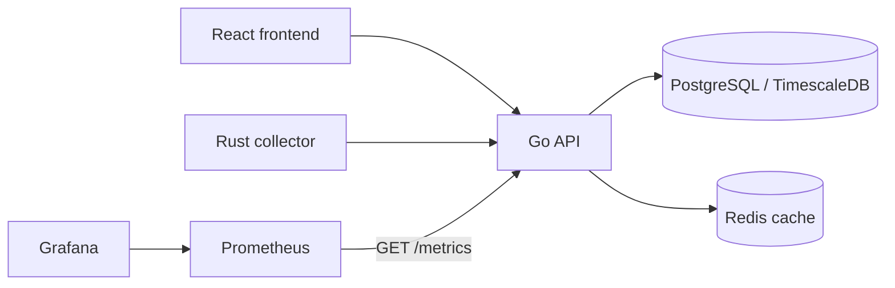

# Architecture

CloudPulse AI is a cloud monitoring platform composed of an API, a metrics collector, persistence services, and an observability stack.

## Components

- **React frontend**: provides the monitoring dashboard and calls the API through `http://localhost:8080`.
- **Go API**: exposes health, metrics, and alert endpoints. It uses Fiber, PostgreSQL, and Redis.
- **Rust collector**: collects infrastructure data and sends it to the API.
- **PostgreSQL with TimescaleDB**: stores time-series metrics and alerts.
- **Redis**: caches recent metrics and alerts.
- **Prometheus**: scrapes the API's `/metrics` endpoint and stores time-series application metrics.
- **Grafana**: visualizes Prometheus data through the dashboards in `deployment/grafana/dashboards`.

## Request and Monitoring Flow

The API middleware records request counts, request duration, and HTTP errors. Prometheus scrapes these metrics every 15 seconds according to `deployment/prometheus/prometheus.yml`.

## Local Ports

| Service | Port | Purpose |
| --- | ---: | --- |
| Go API | `8080` | REST API and Prometheus metrics |
| React frontend | `3000` | Web dashboard |
| PostgreSQL | `5432` | Persistent data |
| Redis | `6379` | Cache |
| Prometheus | `9091` | Metrics storage and query UI |
| Grafana | `3001` | Monitoring dashboards |
| Rust collector | `9090` | Collector metrics |

## Service Discovery

Inside Docker Compose, services communicate through the `cloudpulse-network` bridge network. Prometheus reaches the API at `api:8080`, while the API reaches PostgreSQL at `postgres:5432` and Redis at `redis:6379`.

## Configuration Sources

- `.env.example` documents local environment variables.
- `docker-compose.yml` provides the local service topology.
- `deployment/prometheus/prometheus.yml` configures scraping intervals and targets.
- `deployment/grafana/dashboards/api-dashboard.json` defines the API dashboard panels.
